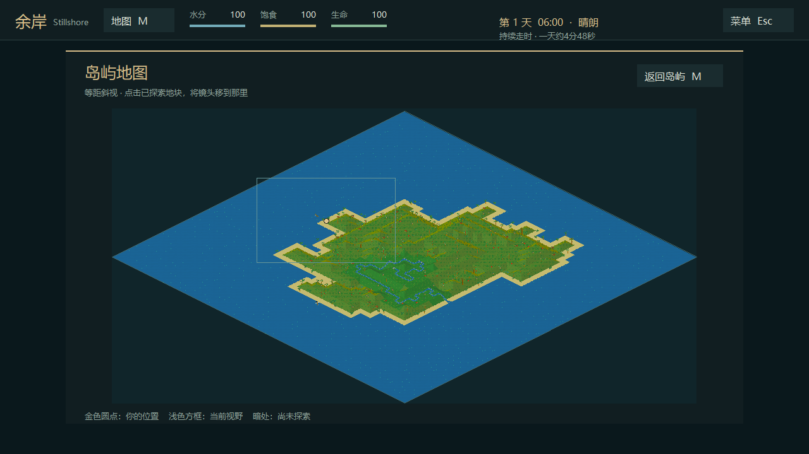

# 余岸 Stillshore

**在荒岛上，重新拾起生活。**

[下载 Windows 预览版](https://github.com/Owful/stillshore/releases) · [游玩指南](docs/游玩指南.md) · [更新记录](CHANGELOG.md) · [原作与署名](#来源与许可)

一场海难之后，你来到一座随机生成的岛屿。寻找淡水，收集食物，制作工具，搭起庇护所；在探索与生存之间安排一天，留下求救的信号，也为明天留一点希望。

**余岸 Stillshore** 是从 [eXpl0it3r/Schiffbruch](https://github.com/eXpl0it3r/Schiffbruch) 建立的中文改进版 Fork，原工作名称为“漂流之境 · 交互修正版”。当前为**探索优化预览版**，保留原作像素角色与地图素材，继续完善中文界面、鼠标交互、显示、声音和生存节奏。

> 平台：Windows x64 · 语言：简体中文 · 类型：单人荒岛生存 · 阶段：预览版

*上图为测试岛屿完整揭示后的等距总览；实际游玩从人物周围逐步探索，不会提前揭开整座岛屿。*

## 下载与开始

前往 [版本下载页](https://github.com/Owful/stillshore/releases) 下载最新的 `Stillshore-…-Windows-x64.zip`，完整解压 **余岸-Stillshore** 文件夹，双击 **开始游戏.vbs**；如果系统禁止运行脚本，也可以直接打开 `bin/Schiffbruch.exe`。首次游玩选“新的旅程”。下载包内不包含个人存档。

旧版存档在 `bin/save.dat`。升级前先备份，再将它放入新版本的 `bin` 文件夹。交互修正版的旧档已做读取与再次保存验证；更早或不同架构的版本未承诺兼容。

## 在岛上做什么

1. **先活下来。** 点击成熟浆果或淡水，人物会走近后进食、饮水；右侧也有明确的“吃东西”和“喝淡水”。
2. **收集与制作。** 搜集树枝、石头、棕叶和藤蔓，制作石斧等工具。制作时人物会做动作，结束时才消耗材料。
3. **赶在夜前安排住处。** 白天 06:00–18:00 约为现实 4 分 48 秒。工作可以在入夜后收尾；附近有可到达的帐篷或树屋时，人物会走进去睡觉。
4. **向岛外求救。** 探索残骸，利用火源与求救标记等待机会。望远镜、藏宝图属于探索发现，不能直接凭空制作。

饥渴下降比旧版慢，但仍需主动寻找补给。低生命和临近入夜会提前提醒，避免毫无征兆地结束旅程。

## 操作速览

| 想做的事 | 操作 |
| --- | --- |
| 移动、取食、饮水 | 单击地块、成熟浆果或淡水 |
| 看周围、调视野 | 右键拖动画面；场景内滚轮缩放 100%–180% |
| 岛屿地图 | 顶部“地图 M”或 `M`；菱形总览中点击已探索地块定位镜头，`M` / `Esc` 返回 |
| 就近互动 | `E` 或底部“互动”按钮 |
| 建造、背包、制作 | `B`、`I`、`C` 或右侧标签 |
| 装水与喝水 | 制作→补给或背包中的独立按钮；`K` 为情境快捷键 |
| 包扎、看目标、暂停 | `J`、`F1`、`Esc` |

砍树需要明确选择“砍伐树木”，普通点击不会因树木恰好在附近而转成砍伐。半成品工程可再次点击继续，面板会显示每种材料的“持有 / 还需 / 缺”。完整操作和生存说明见 [游玩指南](docs/游玩指南.md)，配方与行动关系见 [行动与制作对照](行动与制作对照.md)。

## 本版重点

- 原游戏 141 条文字资源与主要界面统一为简体中文，修正乱码和提示截断。
- 鼠标点击后自动靠近可食植物或淡水，区分移动、进食、饮水、砍伐意图。
- 固定流逝的白天、较缓的基础饥渴、工作收尾与进帐篷睡觉。
- 七种工具、两种补给的制作与材料提示；水壶有独立装水和饮用按钮。
- 喝水、装水和包扎各有不到两秒的短动作，完成后生效；制作保留人物动作并移除场景中的进度框。
- 缩放、动态海水与溪流、分层雨效、砍伐所得提示，以及生命危急预警。
- 调整29个音乐、环境与动作声音，斧击保留原作节奏和重音，进食与饮水使用真实录音；支持环境渐变和独立音量。素材来源与许可见 [声音说明](AUDIO_CREDITS.md)。
- 鼠标点击安静无音效；入夜前的小提示持续5秒，不打断工作，生命危急提醒仍会暂停游戏。
- 稀有的漂流补给箱藏有不同物资；人物与箱子按前后位置遮挡，普通探索以人物周围 3×3 逐步揭开地图。
- 夜晚有约 36 秒的手记，回顾行动、列出实际收获和数量，并伴随轻音乐与轮换的鼓励；阅读 4 秒后可提前进入清晨。
- 更新陆地步行速度；更新点击互动水源和果丛效果。
- 新旅程保留沉船开场；漂流箱使用木石锤砸开，篝火可添柴，并以独立现实秒倒计时、五档大小和名字编号区分。

当前版本已加入鼠标旁小提示、右侧篝火倒计时、底部添柴与动态动作栏，并补上捕鸟自动靠近。详情及后续安排见 [交互调整记录](docs/下一步交互调整.md)。

地图总览与小地图现采用与主场景一致的等距斜视：正方形网格显示为菱形，岛屿形状继续随机生成；仅显示已探索区域。

下一次更新计划：增加两艘沉船位置的随机性、修复通关撤离时的游泳/回弹/瞬移，以及让新指令直接替换旧指令。这三项尚未完成，详见 [待办记录](docs/下一步交互调整.md#下一次更新待办--2026-10-31)。

本版画面主要改进了显示方式、配色、天气和界面。人物与环境素材仍来自原作；新剧情、新场景和全新角色美术尚未做成可发布内容。

早期中文改进版截图

## 构建与参与

源码为 Windows C++17 / CMake / SFML 2.6.2。Visual Studio 2022 的 x64 构建命令、依赖和本地验证范围见 [构建与验证说明](IMPROVEMENTS.zh-CN.md)。[验证记录](验证记录.md)列出自动测试及尚未完成的桌面复核项目。版本变更见 [CHANGELOG](CHANGELOG.md)。

欢迎通过 Issue 反馈可复现的问题，附 Windows 版本、操作步骤及游戏版本即可。请不要上传含个人进度的 `save.dat`。

## 来源与许可

原游戏由 **Dirk Plate** 创作；Windows C++ 移植由 **Lukas Dürrenberger（eXpl0it3r）** 开发；原仓库的历史音乐署名给 **Heiko Plate**。当前版本的重制音频见 [声音来源](AUDIO_CREDITS.md)。本改进版在该移植的基础上调整中文文本、界面、交互、渲染与生存机制。原作者信息见 [原项目说明](README.upstream.md)，原仓库见 [eXpl0it3r/Schiffbruch](https://github.com/eXpl0it3r/Schiffbruch)。

原项目以 [Creative Commons Attribution 4.0 International](LICENSE) 发布；本版保留原素材并标明改动。随包的 SFML、OpenAL Soft 和 C++ 运行库有各自的许可，详见 [第三方组件与源码](THIRD_PARTY.md)及 [licenses](licenses)。原作者与第三方库均未为本改进版背书。

早期中文改进版及历史下载保留于 [Owful/schiffbruch-zh](https://github.com/Owful/schiffbruch-zh)。后续开发和新版本以本 Fork 为主。
